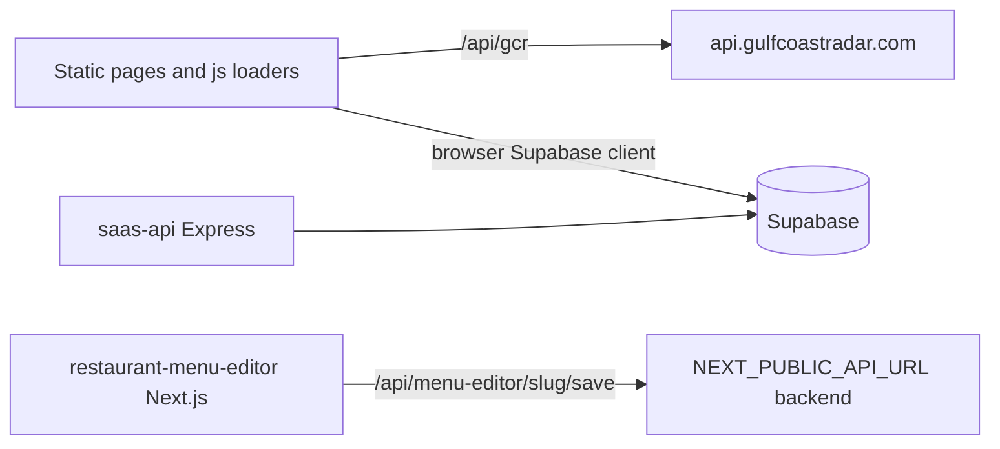

# gcr-trip-swipe-new

An older snapshot of the Gulf Coast Radar website, plus a Next.js menu editor and a small SaaS mini-backend. Despite the name, the Trip Swipe app is not in here.

## What it is

A static directory site for Orange Beach, Gulf Shores and Perdido Key (restaurants, events, happy hours, specials), with an admin area, data-import scripts and many working notes. The only Trip Swipe link is a "Trip Swipe" card type inside the menu editor. The actual Trip Swipe React app lives in `live-gcr-/trip-swipe`. About 458 of the 819 tracked files are committed Next.js build output under `restaurant-menu-editor/.next/`.

## How it works

- Public pages at the repo root: `index.html`, `restaurants.html`, `events.html`, `happy-hours.html`, `profile.html`, `admin-dashboard.html`, `admin-login.html`, and more. `js/` (about 145 files) holds the loaders; `js/config.js` points at `api.gulfcoastradar.com` (or localhost), and some loaders such as `js/business-loader.js` and `js/gcr-supabase-loader.js` read Supabase directly from the browser.
- `restaurant-menu-editor/`: a Next.js 16 / React 19 app (`pages/index.js`) with a PIN-gated editor and card types including Hero, Business and Trip Swipe (`react-tinder-card`). It saves to `${API_URL}/api/menu-editor/<slug>/save`; its own `pages/api/data.js` is a deprecated stub.
- `saas-api/` (Express, `server.js` and `saas-server.js`, routes for auth, apps and user, SQL under `db/`) with a front end in `saas-dashboard/`.
- `CSV-TEMPLATES/`, `data/` and root scripts (`populate-all-data.js`, `import-cobalt-*.js`, `check_*.py`) load business data; some contain a hardcoded path on the original owner's Mac.
- `CYBERCHECK-MODULAR-PLATFORM/` and `cybercheck-login/` are small side folders. The root `package.json` only lists `@supabase/supabase-js`, `cheerio` and `dotenv` for the scripts.
- The many `*.md` files at the root are old working notes, not current documentation.

## Run it

```sh
python3 -m http.server 8000                       # static pages, http://localhost:8000/index.html
cd restaurant-menu-editor && npm install && npm run dev
cd saas-api && npm install && node server.js
```

Environment variable names: menu editor `NEXT_PUBLIC_API_URL`; `saas-api` `SUPABASE_URL`, `SUPABASE_KEY`, `SUPABASE_SERVICE_KEY`, `JWT_SECRET`, `PORT` (see `saas-api/saas-env.example`). The pages depend on external APIs and Supabase projects, and the import scripts need data files that are not in the repo. Not run here.

## Status

Stalled: a mislabeled old GCR snapshot, useful mainly as an archive of early data files and the Next.js menu editor.

## Where it fits



## Related repos

- `live-gcr-`: 33 of the 48 JS filenames shared with it are byte-identical, and it holds the real `trip-swipe/` app.
- `gcr-api-clean`: does today what the menu-editor routes and business-data loaders here did early on.
- `cybercheck-links-`: many URLs here point at `cybercheck-links.vercel.app` and `cybercheck-api-database.vercel.app`.
